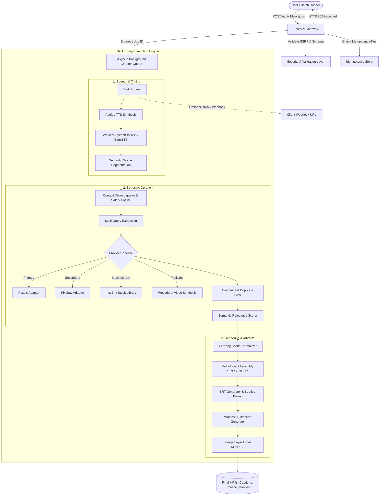

# IncuBrix Script & Voiceover to B-Roll Video Engine

[](https://fastapi.tiangolo.com)
[](https://python.org)
[](https://ffmpeg.org)
[](https://www.docker.com)
[](https://pytest.org)

An intelligent, commercially licensed B-roll video generation engine built for **IncuBrix Engineering Assessment 3**. It converts scripts, voiceover audio, or structured scene lists into finished, broadcast-quality videos with semantic scene matching, precise speech-timed pacing, burn-in captions, multiple aspect ratios (16:9, 9:16, 1:1), and verifiable asset provenance.

---

## Architecture Overview



---

## Key Features

1. **Multi-Input Ingestion**:
   - Audio files (`.mp3`, `.wav`, `.m4a` up to 10 minutes) via upload or URL.
   - Plain script narration via neural TTS (supports Indian English, Hindi, Tamil, US English).
   - Structured IncuBrix scene lists with explicit `visual_hint` guidance.
2. **Hard-Case Disambiguation & Safety**:
   - **Ambiguous Words**: Distinguishes financial bank vs river bank, cloud computing vs sky clouds, python code vs snake, etc.
   - **Abstract Concepts**: Maps metaphors ("trust", "patience") to visual symbols (partnership handshakes, mountain climbers).
   - **Entity Safety**: Automatically suppresses celebrity deepfakes and fake brand logos, providing safe neutral contextual footage.
   - **Avoidance Filters**: Strictly filters clips violating user restrictions (e.g., people's faces, alcohol).
3. **Multi-Aspect Ratio Rendering (16:9, 9:16, 1:1)**:
   - Intelligent 9:16 portrait composite preserving subjects at the edges without stretching or black borders.
   - H.264 video, AAC audio, 30 FPS, 1080p resolution, perfect A/V sync.
4. **Rapid Scene Replacement**:
   - Swap individual scene footage via API; only the target scene is re-rendered, reducing re-render time to seconds.
5. **Full Media Provenance**:
   - `timeline.json` and `manifest.json` record licence details, contributors, source URLs, and selection reasons for every clip.

---

## Setup & Quick Start

### Prerequisites
- Python 3.11+
- FFmpeg 6.0+ on system PATH
- Docker & Docker Compose (optional for containerized run)

### Windows VS Code Setup
1. Clone the repository and open in VS Code:
   ```powershell
   git clone <repo-url>
   cd growthengineer_assessment
   code .
   ```
2. Verify FFmpeg installation:
   ```powershell
   ffmpeg -version
   ```
3. Install Python dependencies:
   ```powershell
   pip install -r requirements.txt
   ```
4. Copy environment configuration:
   ```powershell
   copy .env.example .env
   ```

### Running Locally
Start the server with Uvicorn:
```powershell
python -m uvicorn app.main:app --host 0.0.0.0 --port 8000 --reload
```
- Web Dashboard: [http://localhost:8000/](http://localhost:8000/)
- OpenAPI 3.1 Swagger UI: [http://localhost:8000/docs](http://localhost:8000/docs)
- Health Check: [http://localhost:8000/health](http://localhost:8000/health)
- Readiness Check: [http://localhost:8000/ready](http://localhost:8000/ready)

### Running with Docker Compose
```bash
docker compose up -d
```
Starts API on port 8000, MinIO S3 on port 9000 (Console on 9001).

---

## Running Automated Tests

Run the complete test suite (all unit, integration, e2e, and hidden hard cases) with zero API keys or external dependencies:

```powershell
python -m pytest
```

Output:
```
tests/e2e/test_end_to_end_pipeline.py .                                  [  4%]
tests/hard_cases/test_hidden_test_cases.py .....                         [ 25%]
tests/integration/test_api_endpoints.py ...                              [ 37%]
tests/unit/test_audio_service.py ....                                    [ 54%]
tests/unit/test_scene_service.py ..                                      [ 62%]
tests/unit/test_security_and_idempotency.py ..                           [ 70%]
tests/unit/test_semantic_service.py .......                              [100%]
============================= 24 passed in 33.35s =============================
```

---

## Running the Batch Runner

The command-line batch runner executes test inputs, polls jobs, downloads all assets, and generates summary reports:

```powershell
python scripts/batch_runner.py --input tests/fixtures/10_core_test_inputs.json --output-dir batch_results
```

Results are stored in `batch_results/` with:
- `video_16_9.mp4`, `video_9_16.mp4`
- `captions.srt`
- `timeline.json`
- `manifest.json`
- `batch_summary_report.json` & `batch_summary_report.md`

---

## API Reference & Usage

### 1. Submit Video Generation Job
`POST /api/v1/broll/jobs`  
Header: `Idempotency-Key: <unique-string>`

```json
{
  "script": "Trust is earned slowly. Sales grew 40% in 2025.",
  "voice": "en-IN-female",
  "aspect_ratios": ["16:9", "9:16"],
  "style": "bright, modern, real-world footage",
  "avoid": ["people's faces", "alcohol"],
  "captions": {
    "burn_in": true,
    "srt": true
  }
}
```

Response: `HTTP 202 Accepted`
```json
{
  "job_id": "3e7dc9b1-6127-4b05-8c18-902f225b6c2b",
  "status": "queued",
  "progress": 0,
  "status_url": "/api/v1/jobs/3e7dc9b1-6127-4b05-8c18-902f225b6c2b"
}
```

### 2. Poll Job Status
`GET /api/v1/jobs/{job_id}`

Response:
```json
{
  "job_id": "3e7dc9b1-6127-4b05-8c18-902f225b6c2b",
  "status": "succeeded",
  "progress": 100,
  "stage": "completed",
  "result": {
    "videos": {
      "16:9": "/api/v1/storage/jobs/3e7dc9b1.../video_16_9.mp4",
      "9:16": "/api/v1/storage/jobs/3e7dc9b1.../video_9_16.mp4"
    },
    "captions": "/api/v1/storage/jobs/3e7dc9b1.../captions.srt",
    "timeline": "/api/v1/storage/jobs/3e7dc9b1.../timeline.json",
    "manifest": "/api/v1/storage/jobs/3e7dc9b1.../manifest.json"
  }
}
```

### 3. Rapid Clip Replacement
`POST /api/v1/jobs/{job_id}/scenes/{scene_index}/replace`

```json
{
  "search_query": "futuristic data center server racks glowing blue",
  "source_provider": "mock"
}
```

---

## Standard Error Codes

All errors adhere to IncuBrix Integration Standard #5:

```json
{
  "error": {
    "code": "UPPER_SNAKE_CASE",
    "message": "Readable explanation",
    "retryable": false,
    "details": {}
  }
}
```

| Error Code | HTTP Status | Description |
| :--- | :---: | :--- |
| `INVALID_INPUT` | 400 | Conflicting, missing, or empty input parameters. |
| `SSRF_FORBIDDEN` | 400 | URL resolves to private, loopback, or metadata addresses. |
| `RESOURCE_NOT_FOUND` | 404 | Job ID or asset does not exist. |
| `AUDIO_TOO_LONG` | 413 | Audio duration exceeds 10-minute (600s) boundary. |
| `AUDIO_VALIDATION_ERROR`| 422 | Unsupported extension, invalid container, or zero bytes. |
| `SILENT_AUDIO_ERROR` | 422 | Audio contains no detectable speech or is under silence threshold. |
| `MUSIC_ONLY_AUDIO_ERROR`| 422 | Audio contains background music without speech. |
| `AUDIO_CORRUPTED_ERROR` | 422 | FFprobe could not decode or parse media streams. |
| `VALIDATION_ERROR` | 422 | Pydantic schema validation failure. |
| `PROVIDER_ERROR` | 502 | Upstream stock footage or AI API failure. |
| `RENDERING_ERROR` | 500 | FFmpeg process error during assembly or transcoding. |
| `INTERNAL_SERVER_ERROR` | 500 | Unexpected uncaught system error. |
